# Malicious IP Investigation Report: 45[.]148[.]10[.]141

> **Classification:** Educational / portfolio project (public OSINT only, no internal data)
> **Analyst:** Balusula Philomon
> **Report date:** 2026-11-03
> **Tools used:** VirusTotal, AbuseIPDB, GreyNoise Visualizer
> **Note:** The IP is defanged (`[.]`) in this report so it cannot be clicked or copied into a tool by accident. This is standard practice in SOC reporting.

---

## 1. Executive Summary

The IP address **45[.]148[.]10[.]141** was investigated using open-source threat intelligence. The evidence consistently shows that it is a **malicious, actively attacking host** performing **SSH brute-force attacks and port scanning** against many targets worldwide.

- AbuseIPDB gives it an **Abuse Confidence Score of 100% (Critical)** with **622,862 reports** from 1,692 distinct reporters. The most recent report arrived within about a minute of the check.
- GreyNoise classifies it as **MALICIOUS** with **700,330 observed sessions** touching **84 destination countries**.
- VirusTotal shows **13 of 93** security vendors flagging it, and a Guardpot crowdsourced entry describes **widespread brute-force and service probing**.
- It is hosted on a **data center / web hosting** network (TECHOFF SRV LIMITED, AS48090, Amsterdam, Netherlands). It is not a VPN or Tor exit node.

**Verdict: MALICIOUS (high confidence). Severity: High.**
**Recommended action:** block at the perimeter, search logs for prior contact, and monitor.

---

## 2. Scope and Objective

| Item | Detail |
|---|---|
| Indicator investigated | IPv4 address 45[.]148[.]10[.]141 |
| Objective | Determine whether the IP is malicious, characterize its behavior, and recommend response actions |
| Trigger | Practice investigation of an IP seen in public threat intelligence *(edit this line if you based it on a specific alert or scenario)* |
| Method | Passive OSINT only. No active scanning or interaction with the IP |

---

## 3. Indicator Overview

| Attribute | Value |
|---|---|
| IP address | 45[.]148[.]10[.]141 |
| ISP / Organization | TECHOFF SRV LIMITED |
| ASN | AS48090 |
| Domain name | dmzhost[.]co |
| Usage type | Data Center / Web Hosting / Transit |
| Country | Netherlands |
| City / Region | Amsterdam, North Holland |
| VPN | No (GreyNoise) |
| Tor exit node | No (GreyNoise) |
| Spoofable | False (GreyNoise), meaning the source IP is likely genuine because it completes full connections |
| Reverse DNS | None returned (GreyNoise) |
| Actor attribution | Unknown |

---

## 4. Investigation Findings

### 4.1 VirusTotal

The URL `http://45[.]148[.]10[.]141/` was submitted and analyzed (report dated 2026-10-31 23:11:18 UTC).

| Metric | Result |
|---|---|
| Detection ratio | **13 / 93** |
| First submission | 2019-11-21 15:23:23 UTC |
| Last analysis | 2026-10-31 23:11:18 UTC |
| Categories | alphaMountain.ai: Malicious; Forcepoint ThreatSeeker: malicious web sites |

**Vendor breakdown**

| Verdict | Vendors |
|---|---|
| Malicious (7) | ADMINUSLabs, alphaMountain.ai, Criminal IP, CyRadar, Forcepoint ThreatSeeker, GreyNoise, Lionic |
| Phishing (4) | BitDefender, Certego, G-Data, SOCRadar |
| Malware (2) | Fortinet, VIPRE |
| Suspicious (4) | AlphaSOC, BlockList, Gridinsoft, Guardpot |
| Clean | Majority of remaining vendors (e.g., Abusix, Acronis, AlienVault, CINS Army, Cyble) |

**Crowdsourced context (HIGH, source: Guardpot): "Widespread brute-force and service probing"**

- 1,674 events across 6 attack vectors
- First seen **2026-05-19 04:27 UTC**, last active **2026-10-31 22:07 UTC**
- TCP port scanning / network reconnaissance: 909 events
- linux-realize-connect activity: 335 events
- Remote command execution over vm-process / vm-network / vm-service / vm: 234 / 112 / 47 / 37 events

**Analyst note:** Several vendors label the IP "phishing" or "malware", but the behavior seen elsewhere is SSH brute force and scanning. The URL status and content type were empty, so no web content was observed. The vendor labels are best read as generic "bad IP" verdicts, not evidence of a phishing site.

### 4.2 AbuseIPDB

| Metric | Result |
|---|---|
| Abuse Confidence Score | **100% (Critical)** |
| Total reports | **622,862** from **1,692** distinct reporters |
| First reported | 9 February 2021 |
| Most recent report | Under 1 minute before the check (still active) |
| Last 60 days | 137,356 reports from 915 reporters, roughly 350 reporters per day |
| Top reporter countries | Germany (51,522), USA (17,628), France (15,972) |

**Most common report categories**

| Category | Reports |
|---|---|
| Brute-Force | 134,377 |
| SSH | 131,990 |
| Port Scan | 3,869 |
| Hacking | 2,593 |
| Exploited Host | 1,412 |

**Report searches (last 365 days)**

| Search term | Reports |
|---|---|
| `ssh` | 9,840 |
| `port scan` | 302 |
| `ddos` | 30 |
| `web spam` | 24 |

**Log evidence from reporters (2026-11-02 to 2026-11-03 UTC)**

- Repeated `sshd` entries of the form *"Failed password for root from 45[.]148[.]10[.]141 port <random> ssh2"* and `pam_unix(sshd:auth): authentication failure ... user=root`
- The **root** account is the target in the sampled logs, and the source port changes with every attempt, typical of automated tooling
- Many reporters use automated defenses (e.g., Fail2Ban jails and bans), showing the IP is blocked in many places
- Honeypot sensors (e.g., "Low-interaction honeypot observation", "Port honeypot probe detected on port 22") also logged unsolicited SSH connections
- One report mentions an unsolicited connection to a **Pterodactyl Wings** server (a game-server management daemon), suggesting opportunistic scanning of exposed services

**Analyst note:** The "DDoS Attack", "Ping of Death" and "Web Spam" categories come mainly from one reporter that tags many categories on every report. The comment text in those reports is the same SSH failed-password log line. These categories are likely over-tagged, so the core behavior is **SSH brute force and scanning**, not DDoS or spam.

### 4.3 WHOIS (via AbuseIPDB)

| Field | Value |
|---|---|
| ISP | TECHOFF SRV LIMITED |
| Usage type | Data Center / Web Hosting / Transit |
| Domain | dmzhost[.]co |
| Country | Netherlands |
| City | Amsterdam, North Holland |

The IP belongs to a hosting provider, a common source of attack infrastructure because servers are cheap to rent and easy to rotate.

### 4.4 GreyNoise

| Field | Value |
|---|---|
| Classification | **MALICIOUS** |
| Type | Hosting |
| Last seen | 2026-11-03 |
| Sessions observed | 700,330 |
| Destination countries | 84 |
| Tags | 5 |

**Related tags**

- SSH Bruteforcer
- SSH Connection Attempt
- SSH Alternative Port Crawler
- Generic Sensitive File Access Attempt
- Generic Path Traversal Attempt

**Analyst notes**

- The IP scans the **entire internet**: 84 destination countries means it is not targeting a single organization.
- "SSH Alternative Port Crawler" means it probes non-standard SSH ports, so moving SSH off port 22 does not protect a host by itself.
- The path traversal and sensitive file tags suggest it also tries basic web-application probing.
- The timeline view (free plan, 2-day window) shows the classification as *suspicious* with the SSH tags active across Nov 2-3, while the overview shows *malicious*. The overview reflects the broader history.

---

## 5. Analysis

| Question | Assessment |
|---|---|
| Is the IP malicious? | **Yes.** Multiple independent sources agree (AbuseIPDB, GreyNoise, VirusTotal vendors, honeypots). |
| What is it doing? | Automated **SSH brute-force** (targeting `root`), **port scanning**, and probing of web paths. |
| Is it still active? | **Yes.** Reports arrived within the last minute, and GreyNoise last seen is 2026-11-03. |
| Long-running? | **Yes.** AbuseIPDB reports date back to Feb 2021 and Guardpot activity to May 2026 (VirusTotal first saw the URL in Nov 2019). |
| Targeted or opportunistic? | **Opportunistic mass scanning.** It hits hosts in 84 countries with no sign of a specific victim. |
| Is the source spoofed? | **No.** GreyNoise reports Spoofable = False, so full TCP connections are being made. |
| Any evidence of successful compromise? | **None found.** All observed activity is failed authentication or reconnaissance. |

**Confidence level: High.** The sources are independent and agree. The data is large-scale, recent, and confirmed by honeypots.

---

## 6. MITRE ATT&CK Mapping

| Tactic | Technique | ID | Evidence |
|---|---|---|---|
| Reconnaissance | Active Scanning | T1595 | Internet-wide scanning (84 countries) |
| Discovery | Network Service Discovery | T1046 | Port scan reports, honeypot hits |
| Credential Access | Brute Force: Password Guessing | T1110.001 | Repeated failed SSH logins for `root` |
| Initial Access (attempted) | Remote Services: SSH | T1021.004 | SSH connection attempts on port 22 and alternative ports |
| Initial Access (possible) | Exploit Public-Facing Application | T1190 | GreyNoise path traversal / sensitive file access tags *(lower confidence)* |

---

## 7. Indicators of Compromise (IOCs)

| Type | Value | Context |
|---|---|---|
| IPv4 | 45[.]148[.]10[.]141 | Primary indicator, malicious scanner / brute-forcer |
| Domain | dmzhost[.]co | Domain associated with the IP in WHOIS data |
| ASN | AS48090 (TECHOFF SRV LIMITED) | Hosting network |
| URL | hxxp://45[.]148[.]10[.]141/ | URL submitted to VirusTotal (13/93) |

---

## 8. Recommendations

**Immediate**
1. **Block** 45[.]148[.]10[.]141 at the firewall / IPS (inbound and outbound).
2. **Search logs** (SIEM, auth logs, firewall) for any connection to or from this IP, especially for SSH logins (successful *and* failed).
3. If any **successful** login from this IP is found, treat it as a **confirmed incident**: isolate the host, reset credentials, and review for persistence.

**Hardening**
4. Disable SSH password authentication and use **key-based authentication**.
5. Disable **direct root login** over SSH (`PermitRootLogin no`).
6. Deploy **Fail2Ban** or equivalent rate limiting, and restrict SSH to trusted IPs or a VPN.
7. Do not rely on changing the SSH port, since the IP crawls alternative ports.

**Monitoring**
8. Add the IP to a **watchlist / threat intel feed** in the SIEM.
9. Consider reviewing the wider **AS48090** range if more related malicious IPs appear.
10. Re-check the IP's reputation periodically, since hosting-provider IPs can be reassigned.

---

## 9. Limitations and Next Steps

- Only three platforms were used. Additional sources such as Shodan/Censys (open ports), Cisco Talos, IBM X-Force, and AlienVault OTX would strengthen the report.
- No passive DNS or malware-sample correlation was performed.
- GreyNoise timeline data is limited to a 2-day window on the free plan.
- VirusTotal was queried as a URL, which may not capture all IP-level data (e.g., passive DNS, communicating files).
- Nothing was verified against a real internal environment, so no impact assessment is possible.
- Next steps: check the rest of the AS48090 range, and correlate with internal logs if this were a live case.

---

## 10. Evidence (Screenshots)

Screenshots are stored in the `screenshots/` folder.

### VirusTotal

**Detection score (13/93)**

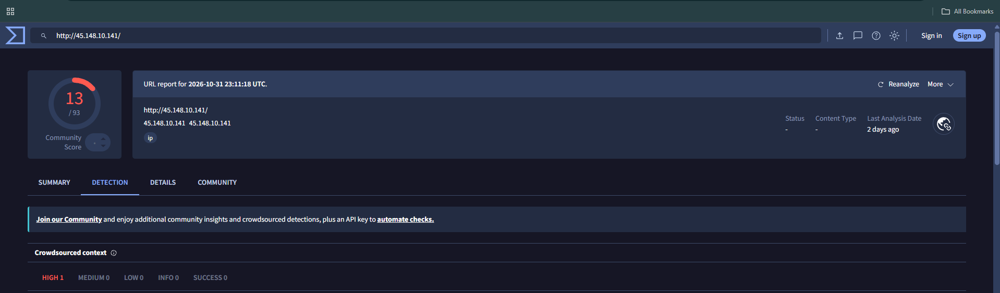

**Crowdsourced context and vendor verdicts**

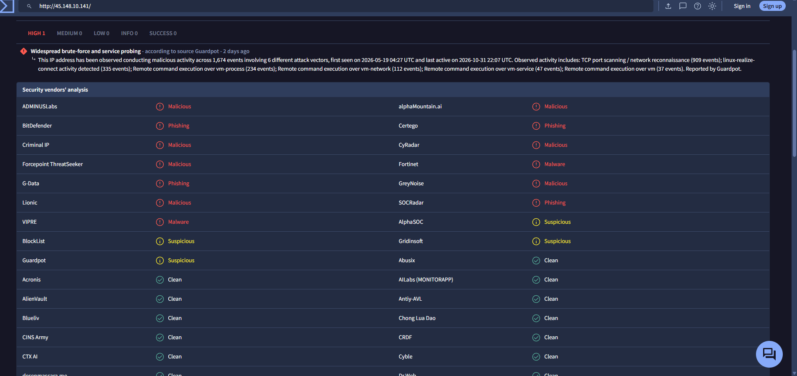

**Categories and submission history**

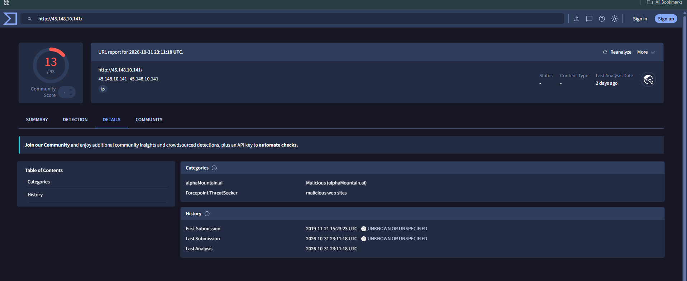

### AbuseIPDB

**Confidence score, ISP, ASN and report statistics**

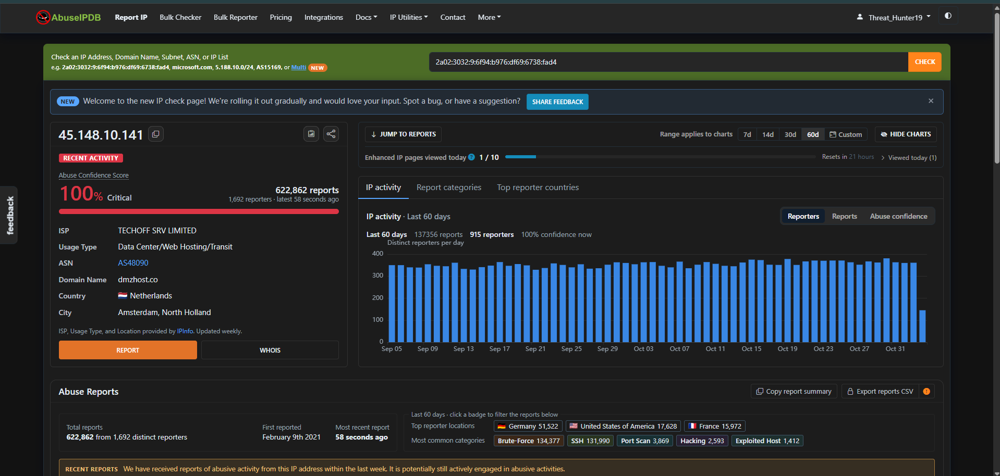

**SSH brute-force log evidence**

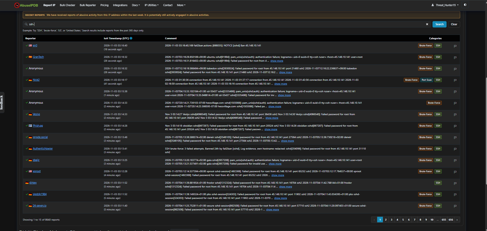

**Port scan and honeypot reports**

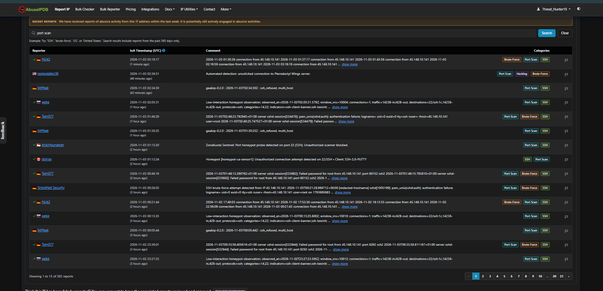

**DDoS-tagged reports (over-tagging noted in section 4.2)**

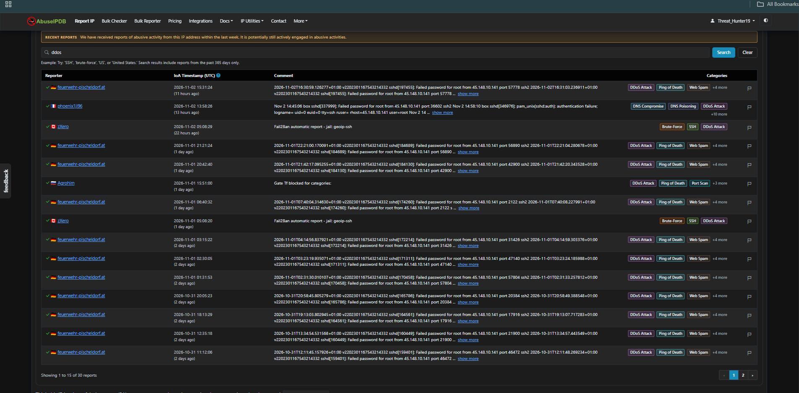

**Web spam-tagged reports**

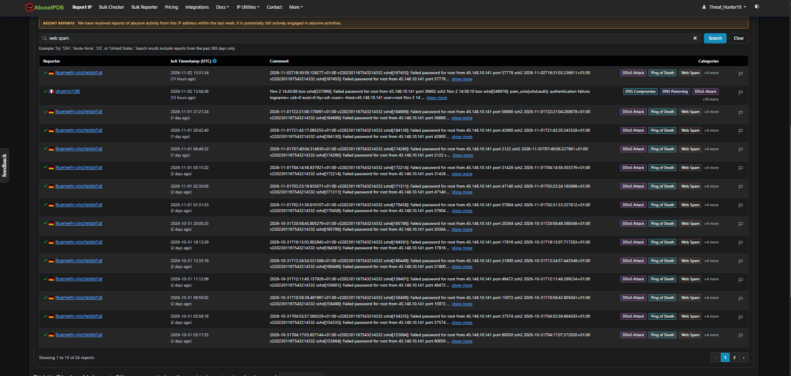

**WHOIS information**

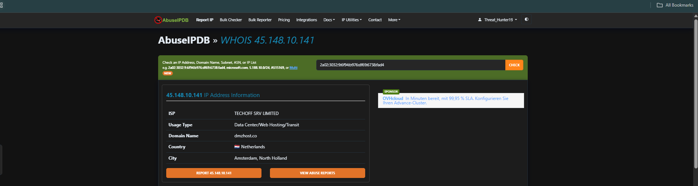

### GreyNoise

**Classification, metadata and related tags**

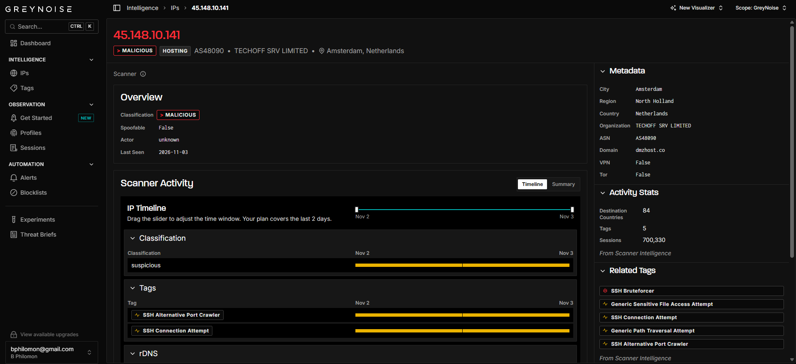

**Scanner activity timeline**

**Destination countries summary**

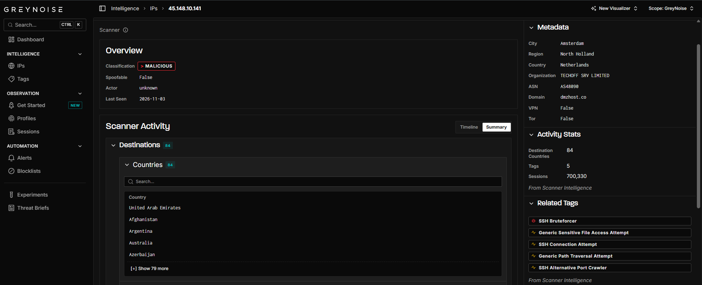

---

## 11. References

- VirusTotal: https://www.virustotal.com
- AbuseIPDB: https://www.abuseipdb.com/check/45.148.10.141
- GreyNoise Visualizer: https://viz.greynoise.io/ips/45.148.10.141
- MITRE ATT&CK: https://attack.mitre.org

---

*This report is for educational purposes. All data comes from public OSINT sources as of 2026-11-03 and may change over time.*
